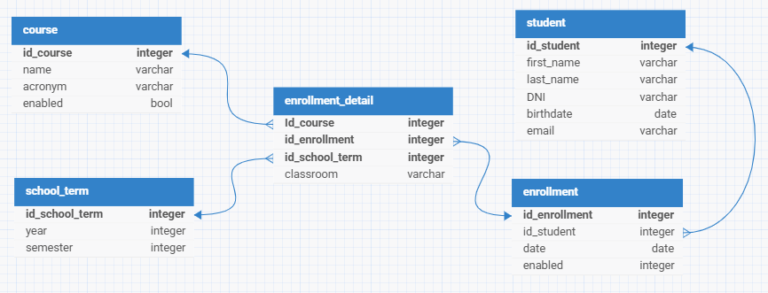

# appfrv-students

API REST para gestionar información académica: estudiantes, cursos, términos lectivos (año y semestre), inscripciones y el detalle de cada inscripción (qué cursos cursa un estudiante en cada término y en qué aula). Está hecha con Java 25 y Spring Boot 4, y guarda los datos en PostgreSQL.

## Tecnologías

- Java 25
- Spring Boot 4.1.1 (Spring Web MVC, Spring Data JPA y Bean Validation)
- PostgreSQL (driver JDBC incluido)
- ModelMapper 3.2.6, para convertir entidades en DTOs y viceversa
- Lombok
- Maven, con wrapper incluido (`mvnw`): no hace falta instalarlo

## Modelo de datos



| Entidad | Tabla | Descripción |
|---|---|---|
| `Student` | `student` | Estudiante: nombre, apellido, DNI, fecha de nacimiento y email |
| `Course` | `course` | Curso: nombre, sigla opcional y si está habilitado |
| `SchoolTerm` | `school_term` | Término lectivo: año y semestre (la combinación es única) |
| `Enroll` | `enroll` | Inscripción de un estudiante: fecha y si está habilitada |
| `EnrollDetail` | `enroll_detail` | Curso cursado dentro de una inscripción, en un término, con su aula. Clave compuesta: término + inscripción + curso |

Un `Student` tiene muchas `Enroll`, y cada `Enroll` tiene muchos `EnrollDetail`. Cada `Course` y cada `SchoolTerm` aparece en muchos `EnrollDetail`.

## Requisitos

- JDK 25
- PostgreSQL en ejecución (por defecto en `localhost:5432`)
- `psql` en el PATH, solo si quieres cargar los datos de ejemplo

## Configuración de la base de datos

1. Crea la base de datos:

   ```sql
   CREATE DATABASE db_students_frv;
   ```

2. La conexión se define en `src/main/resources/application.yaml` y se puede sobrescribir con variables de entorno:

   | Variable | Valor por defecto |
   |---|---|
   | `DB_URL` | `jdbc:postgresql://localhost:5432/db_students_frv` |
   | `DB_USERNAME` | `postgres` |
   | `DB_PASSWORD` | Ver `application.yaml` |

3. Las tablas las crea Hibernate al arrancar la aplicación (`ddl-auto: update`). El proyecto no usa herramientas de migraciones.

## Ejecución

```bash
git clone https://github.com/valentefr/app_student-academic-java.git
cd app_student-academic-java

./mvnw spring-boot:run          # Linux, macOS o Git Bash
.\mvnw.cmd spring-boot:run      # Windows (PowerShell o CMD)
```

La API queda disponible en `http://localhost:8080`.

Para generar un JAR y ejecutarlo:

```bash
./mvnw clean package
java -jar target/app-students-0.0.1-SNAPSHOT.jar
```

### Datos de ejemplo (opcional)

Ejecuta el script **después** de arrancar la aplicación al menos una vez, para que Hibernate haya creado las tablas:

```bash
psql -h localhost -U postgres -d db_students_frv -f db/seed-data.sql
```

Carga 20 estudiantes, 10 cursos, 4 términos (2024 y 2025), 15 inscripciones y 34 detalles de inscripción. Usa ids fijos y `ON CONFLICT DO NOTHING`, así que volver a ejecutarlo no duplica los registros del seed.

### Tests

```bash
./mvnw test
```

El único test (`AppfrvStudentsApplicationTests`) carga el contexto completo de Spring, así que necesita PostgreSQL accesible con la configuración anterior.

## API

Todos los endpoints usan JSON y el prefijo `/v1`. Los ids se generan automáticamente, así que no los envíes en `POST`.

### Recursos

`students`, `courses`, `schoolterms` y `enrolls` exponen el mismo CRUD:

| Método | Ruta | Respuesta |
|---|---|---|
| `GET` | `{base}` | `200` con la lista completa |
| `GET` | `{base}/{id}` | `200` · `404` |
| `POST` | `{base}` | `201` con el recurso creado, incluido su id |
| `PUT` | `{base}/{id}` | `200` con el recurso actualizado · `404` |
| `DELETE` | `{base}/{id}` | `204` · `404` |

| Recurso | Base | Campos del body |
|---|---|---|
| Estudiantes | `/v1/students` | `firstName` y `lastName` (1–50 caracteres), `DNI` (1–10 caracteres; la clave en el JSON es `DNI`, en mayúsculas), `birthDate` (`yyyy-MM-dd`), `email` (formato válido, máximo 50). Todos obligatorios |
| Cursos | `/v1/courses` | `name` (obligatorio, máximo 100), `acronym` (opcional, máximo 20), `enabled` (obligatorio) |
| Términos lectivos | `/v1/schoolterms` | `year` (entre 1900 y 2200) y `semester` (1 o 2), obligatorios |
| Inscripciones | `/v1/enrolls` | `student` (objeto, obligatorio), `date` (`yyyy-MM-dd`, obligatorio), `enabled` (obligatorio) |
| Detalles de inscripción | `/v1/enrolldetails` | `idEnrollDetail` (objeto con `schoolTerm`, `enroll` y `course`) y `classRoom` (obligatorio, máximo 20) |

`/v1/enrolldetails` tiene el mismo CRUD, pero su clave es compuesta y va en la ruta: `/v1/enrolldetails/{idSchoolTerm}/{idEnroll}/{idCourse}`. En `PUT`, la clave de la ruta prevalece sobre la del body.

### Consulta: cursos con estudiantes

`GET /v1/enrolldetails/course-students`

| Parámetro | Tipo | Descripción |
|---|---|---|
| `enabled` | `true` / `false` | Opcional. Filtra por el estado del **curso** (`Course.enabled`) |
| `year` | Entero | Opcional. Considera solo las inscripciones de términos de ese año |

- Devuelve un elemento por curso con inscripciones. Los cursos sin inscripciones no aparecen.
- Cada estudiante aparece una sola vez por curso, aunque tenga varias inscripciones en el año filtrado.
- Orden: por nombre del curso, y luego por apellido y nombre del estudiante.
- Sin resultados responde `200` con `[]`. Un valor inválido, como `year=abc`, responde `400`.

Ejemplo de un elemento de `GET /v1/enrolldetails/course-students?year=2025&enabled=true`, con los datos de `seed-data.sql`:

```json
{
  "idCourse": 7,
  "acronym": "BD",
  "name": "Bases de Datos",
  "students": [
    { "dni": "32140985", "firstName": "Benjamin", "lastName": "Ferreyra" },
    { "dni": "30267941", "firstName": "Santiago", "lastName": "Peralta" },
    { "dni": "30548216", "firstName": "Emilia", "lastName": "Quiroga" }
  ]
}
```

La especificación completa de esta consulta, con sus decisiones de diseño, está en `.agents/features/queries/spec/spec.md`.

### Ejemplos

Los ejemplos usan `curl` desde Bash (Git Bash, Linux o macOS). En PowerShell, `curl` es un alias de `Invoke-WebRequest`: usa `curl.exe`.

Crear un estudiante:

```bash
curl -X POST http://localhost:8080/v1/students \
  -H "Content-Type: application/json" \
  -d '{
    "firstName": "Ana",
    "lastName": "Lopez",
    "DNI": "30111222",
    "birthDate": "2003-05-10",
    "email": "ana.lopez@example.com"
  }'
```

Respuesta `201 Created`:

```json
{
  "idStudent": 21,
  "firstName": "Ana",
  "lastName": "Lopez",
  "DNI": "30111222",
  "birthDate": "2003-05-10",
  "email": "ana.lopez@example.com"
}
```

Crear un detalle de inscripción. Con los datos de ejemplo cargados, la inscripción 11 tiene detalles en el término 4. Para referenciar registros existentes basta con enviar su id dentro de cada objeto:

```bash
curl -X POST http://localhost:8080/v1/enrolldetails \
  -H "Content-Type: application/json" \
  -d '{
    "idEnrollDetail": {
      "schoolTerm": { "idSchoolTerm": 4 },
      "enroll": { "idEnroll": 11 },
      "course": { "idCourse": 5 }
    },
    "classRoom": "Aula 205"
  }'
```

Ese detalle queda accesible en `/v1/enrolldetails/4/11/5`, así que se consulta, actualiza o borra con esa ruta.

Consultar un recurso que no existe:

```bash
curl http://localhost:8080/v1/students/999
```

Respuesta `404 Not Found`:

```json
{
  "timestamp": "2026-10-27T10:20:37.6473053",
  "message": "ID NOT FOUND: 999",
  "path": "uri=/v1/students/999"
}
```

### Errores

| Código | Cuándo |
|---|---|
| `400 Bad Request` | Falla una validación del body (el `message` indica el campo), o un parámetro tiene un tipo inválido |
| `404 Not Found` | No existe un registro con ese id |
| `406 Not Acceptable` | Se lanza `ArithmeticException` o `NumberFormatException` |
| `500 Internal Server Error` | Cualquier otro error no controlado |

## Arquitectura

- **Controladores** (`controller/`): exponen los endpoints, reciben y devuelven DTOs, y nunca exponen entidades. La conversión la hace `ModelMapper` (bean definido en `config/MapperConfig`).
- **Servicios** (`service/`): `ICRUD<T, ID>` y `CRUDImpl<T, ID>` contienen la lógica CRUD genérica. Cada servicio concreto la hereda y entrega su repositorio mediante `getRepo()`.
- **Repositorios** (`repo/`): extienden `IGenericRepo<T, ID>`, que a su vez extiende `JpaRepository`. Solo `IEnrollDetailRepo` tiene una consulta propia.
- **DTOs** (`dto/`): contienen las validaciones (`jakarta.validation`). Las entidades solo declaran restricciones de columna.
- **Errores**: `config/GlobalErrorHandler` (`@RestControllerAdvice`) centraliza las respuestas de error.

Convención importante: la clave primaria de cada entidad debe llamarse `id<NombreEntidad>` (por ejemplo, `idStudent`). `CRUDImpl.update` busca por reflexión el setter `setId<NombreEntidad>`; si el nombre no coincide, la actualización falla.

Para agregar una entidad nueva, replica el patrón de cinco archivos (modelo, DTO, repositorio, interfaz e implementación del servicio, y controlador) a partir de `Student` o `Course`. El diagrama de clases de repositorios y servicios está en [`docs/repo-service-uml-diagram.md`](docs/repo-service-uml-diagram.md).

## Estructura del proyecto

```
.
├── db/
│   └── seed-data.sql              # Datos de ejemplo
├── docs/                          # Diagramas (ER y clases) en .md y .png
├── src/
│   ├── main/
│   │   ├── java/com/vflores/
│   │   │   ├── config/            # ModelMapper y manejo global de errores
│   │   │   ├── controller/        # Endpoints REST
│   │   │   ├── dto/               # DTOs con validaciones
│   │   │   │   └── queries/       # DTOs de la consulta course-students
│   │   │   ├── model/             # Entidades JPA
│   │   │   ├── repo/              # Repositorios Spring Data
│   │   │   └── service/           # Interfaces y servicios (impl/)
│   │   └── resources/
│   │       └── application.yaml
│   └── test/                      # Tests
├── mvnw
├── mvnw.cmd
└── pom.xml
```

## Limitaciones conocidas

- **Sin autenticación ni autorización**: cualquiera que llegue a la API puede leer, crear, modificar y borrar datos.
- **Sin paginación ni ordenamiento configurable** en los listados.
- **Detalle por ruta con datos incompletos**: `GET /v1/enrolldetails/{idSchoolTerm}/{idEnroll}/{idCourse}` devuelve `schoolTerm`, `enroll` y `course` solo con su id, y `enabled: false` en `enroll` y `course`. El listado `GET /v1/enrolldetails` sí devuelve los datos completos.
- **Referencias sin comprobar**: si `student`, `schoolTerm`, `enroll` o `course` apuntan a un id inexistente, o si un `DELETE` rompe una referencia (por ejemplo, borrar un estudiante que tiene inscripciones), la base de datos rechaza la operación y la API responde `500`.
- **`POST` con id existente**: si el body trae un id que ya existe, se actualiza ese registro en lugar de crear uno nuevo (Spring Data usa `merge`). En `POST /v1/enrolldetails` la clave siempre viene en el body, así que esa ruta funciona como upsert.
