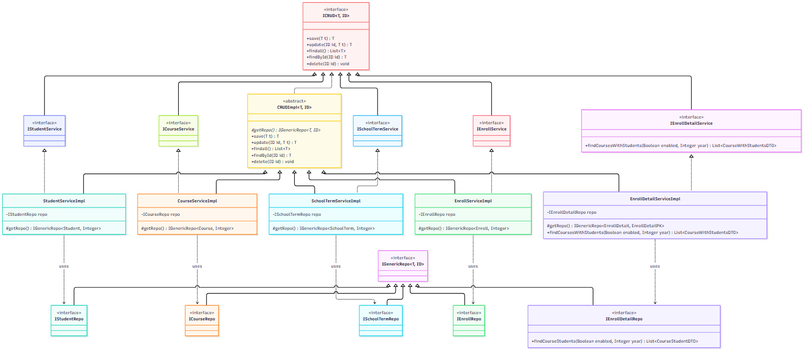
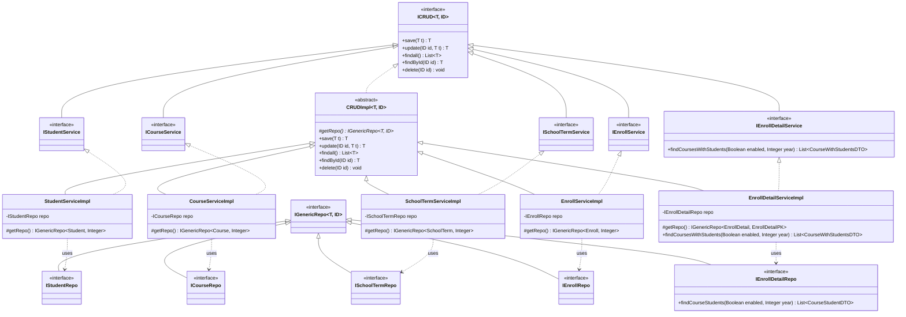

# Repo & Service Layer UML Class Diagram

## Notes

* `IGenericRepo<T, ID>` is a `@NoRepositoryBean` base over Spring Data's `JpaRepository<T, ID>`; every per-entity repo (`IStudentRepo`, `ICourseRepo`, `ISchoolTermRepo`, `IEnrollRepo`, `IEnrollDetailRepo`) only extends it — no custom methods except `IEnrollDetailRepo.findCourseStudents`.
* `ICRUD<T, ID>` + `CRUDImpl<T, ID>` hold all generic CRUD logic (`save`, `update`, `findall`, `findById`, `delete`). Concrete services implement a marker interface (`IStudentService extends ICRUD<...>`, etc.) and extend `CRUDImpl`, supplying their repo via the abstract `getRepo()` hook.
* `IEnrollDetailService`/`EnrollDetailServiceImpl` is the one vertical that adds real logic on top of the generic base: `findCoursesWithStudents` groups the flat rows from `IEnrollDetailRepo.findCourseStudents` by course.
* `CRUDImpl.update` relies on the `set + EntityName` reflective naming convention described in `CLAUDE.md`; it is not visible in this class-level diagram.
